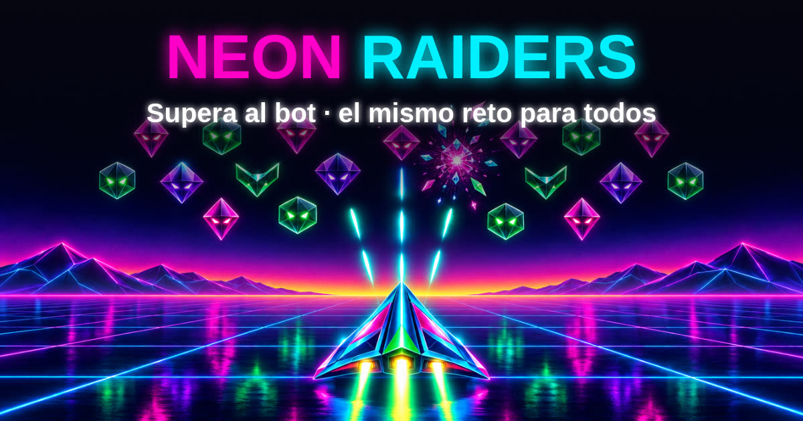

# Neon Raiders

**Un reto de arcade nuevo cada día, igual para todos.** Juego de navegador de código abierto, hecho con JavaScript,
CSS y HTML puros: sin frameworks, sin paso de compilación, sin registro.

- **Jugar:** [games.johnandrestrujillo.com/play/neon-raiders](https://games.johnandrestrujillo.com/play/neon-raiders)
- **Controles:** flechas o arrastrar para moverte, Espacio o tocar para disparar, P para pausar.

*English: a new arcade challenge every day, the same for everyone. Open-source browser game in plain JavaScript.
Add `?lang=en` for English.*



## Qué tiene

- **Reto diario.** Cada día trae las mismas oleadas y las mismas naves bonus para todos los jugadores.
  Tu mejor puntaje del día y tu racha se guardan en tu navegador. Detalles en [docs/DAILY.md](docs/DAILY.md).
- **Compartir en un toque.** Al terminar, compartes tu resultado como texto; el enlace lleva al portal.
- **Hecho para el teléfono.** Controles táctiles, vertical y horizontal.
- **Temas.** El aspecto cambia con una carpeta de imágenes, sin tocar la dificultad.
  Formato en [docs/THEMES.md](docs/THEMES.md).
- **Español e inglés.**
- **Medición anónima.** Contadores sin cookies ni identificadores, que respetan "Do Not Track".
  Qué se envía exactamente: [docs/DAILY.md](docs/DAILY.md#anonymous-measurement).

## Probarlo en tu máquina

```
python3 -m http.server 8000
```

y abre <http://localhost:8000>. Para ver otro tema: `?theme=demo-espacio`. Para jugar el reto de otro día:
`?debug=true&day=2026-11-20`.

## Hoja de ruta

- Enemigos que salen de la formación en picada y enemigos blindados.
- Entrada en vuelo de las oleadas.
- Más temas.

Las ideas y los pull requests son bienvenidos.

## Créditos y licencia

Neon Raiders es un fork de [dwmkerr/spaceinvaders](https://github.com/dwmkerr/spaceinvaders), de Dave Kerr, un
ejercicio de aprendizaje publicado con licencia MIT. Gracias, Dave.

Cambios de este fork:

- Nombre y textos nuevos, en español e inglés.
- Reto diario con formaciones por fecha, nave bonus, racha y resultado para compartir.
- Controles táctiles y diseño adaptable al teléfono.
- Sistema de temas con imágenes intercambiables.
- Efectos de sonido nuevos, sintetizados desde cero. Los sonidos originales venían del arcade de 1978 y no estaban
  cubiertos por la licencia MIT, así que se quitaron.
- Se quitaron la etiqueta de Google Analytics, el botón de patrocinio, la configuración de Replit y el proyecto
  `jev-invaders`, que no tenía relación.
- Un gancho opcional informa el puntaje final a los portales que ofrecen `window.PortalSDK`.

Publicado con [licencia MIT](LICENSE). Se conserva el aviso de copyright original, y los cambios desde 2026 son
copyright de John Andrés Trujillo. Este proyecto no está afiliado ni respaldado por los dueños de ningún juego de
arcade clásico ni de sus marcas.
